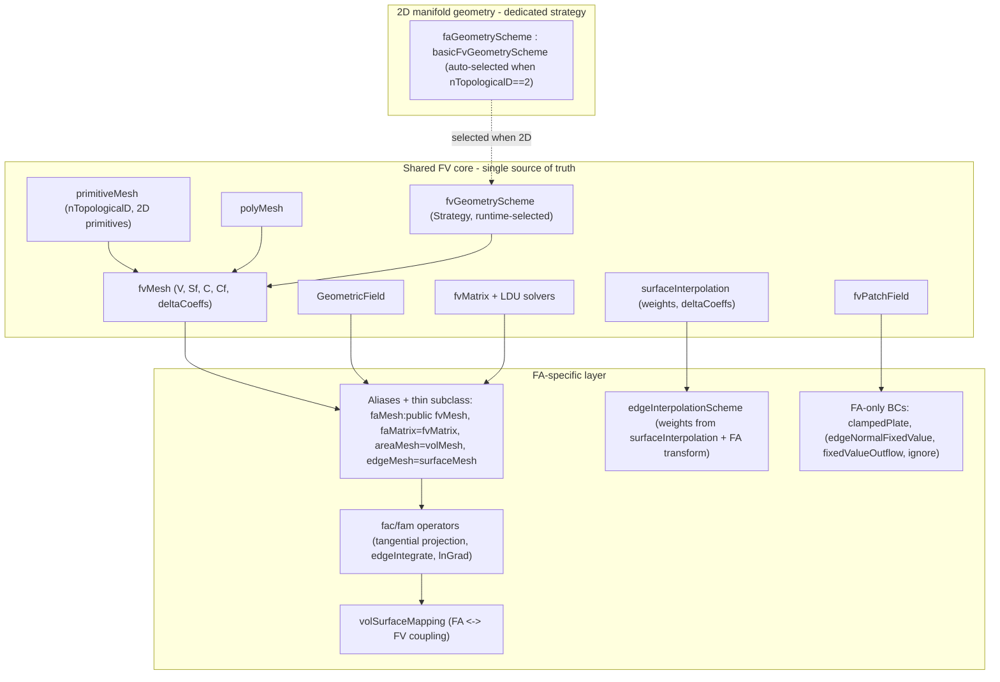

# 3. Code architecture

[← Changes](02-changes-from-finiteArea.md) · [Index](README.md) · [Next: Geometry & schemes →](04-geometry-and-schemes.md)

## 3.1 Layering



Principle: **everything the two methods share lives once in the FV core**; FA is
a thin layer of *aliases + genuinely-different numerics*.

## 3.2 The `faMesh : public fvMesh` decision (D1)

A pure `typedef fvMesh faMesh` was the original intent but is insufficient: the
FA↔3-D bridge `volSurfaceMapping` needs the parent polyMesh face for each FA cell,
and a typedef has nowhere to store that coupling state. The chosen design
(decision **D1**, option A) is a **thin subclass** that owns only the coupling
addressing and registry hooks:

```cpp
class faMesh : public fvMesh
{
    word areaName_;
    labelList meshFaces_;        // parent-mesh face per local FA cell
    labelList meshPointLabels_;  // parent-mesh point per FA point
    // + demand-driven coupling (whichPatchFaces, patch(), ...)
};
```

Key members (see [`src/finiteArea/faMesh/faMesh.H`](../../src/finiteArea/faMesh/faMesh.H)):

- `meshFaces()` / `faceLabels()` — parent faces this region maps onto.
- `whichFace(meshFacei)` — inverse lookup (parent face → FA cell, or −1).
- `pointLabels()` — parent point per FA point (needed by parallel addressing).
- `S()`/`S0()`/`S00()` — area accessors aliasing `V()`/`V0()`/`V00()`.
- `patch()`, `whichPatchFaces()`, `whichPolyPatches()` — demand-driven coupling.
- Static selectors `TryNew(...)`, `hasMeshFiles(...)`, `mesh(...)`,
  `Registry(...)` — mirror the legacy selector semantics.

The subclass keeps Liskov substitutability: a 2-D `faMesh` must be usable
wherever an `fvMesh` is expected.

## 3.3 Type-alias layer

| Alias | Defined in | Meaning |
|-------|-----------|---------|
| `areaMesh` = `volMesh` | `fields/areaFields/areaFieldsFwd.H` | area field = vol field |
| `edgeMesh` = `surfaceMesh` | `fields/edgeFields/edgeFieldsFwd.H` | edge field = surface field |
| `faPatchField` = `fvPatchField` | `areaFieldsFwd.H` | |
| `faePatchField` = `fvsPatchField` | `edgeFieldsFwd.H` | |
| `faPatchFieldBase` = `fvPatchFieldBase` | `areaFieldsFwd.H` | |
| `faMatrix<T>` = `fvMatrix<T>` | `faMatrices/faMatrices.H` | `faScalarMatrix` = `fvScalarMatrix` |
| `faPatch` = `fvPatch` | (patch policy, Phase 3) | |

Predicates `fieldTypes2::is_area` / `is_area_internal` classify FA field class
names (used by e.g. `areaWrite`).

### Back-compatibility forwarding headers (`compat/`)

So that downstream code written against the earlier finiteArea public API keeps
compiling against the current library, a set of header-only forwarders lives in
[`src/finiteArea/compat/`](../../src/finiteArea/compat). They add **no** new
symbols beyond the aliases above — they just make the legacy `#include` *names*
resolve:

| Legacy header | Forwards to |
|---|---|
| `faMatrix.H`, `faScalarMatrix.H`, `faMatricesFwd.H` | `faMatrices.H` |
| `faPatch.H` | `fvPatch.H` + `areaFieldsFwd.H` (`faPatch = fvPatch`) |
| `faPatchField.H`, `faPatchFields.H`, `faPatchFieldsFwd.H` | `fvPatchField(s)(Fwd).H` + `areaFieldsFwd.H` |
| `faePatchField.H`, `faePatchFields.H`, `faePatchFieldsFwd.H` | `fvsPatchField(s)(Fwd).H` + `edgeFieldsFwd.H` |
| `faBoundaryMesh.H` | `fvBoundaryMesh.H` + `typedef fvBoundaryMesh faBoundaryMesh` |

Not everything is shimmable: the deleted `edgeInterpolation` MeshObject
(weights now delegate to `surfaceInterpolation`), the per-type `…FaPatchField`
BC *class* names (use the `…Fv[s]PatchField` equivalents; run-time selection is
unchanged), the `faSchemes`/`faSolution` classes (use `fvSchemes`/`fvSolution`,
D2), the sliced-FA-field family (`areaFaMesh`/`slicedAreaField`/
`slicedFaPatchField` — needs distinct class templates the alias design does not
provide) and the `faMeshSubset`/mapper/`MapFaFields` internals (reuse the FV
equivalents) remain consumer-facing changes. Use the current FV equivalents for
new code.

## 3.4 Registry & construction

- FA objects live in a per-parent sub-registry named `finite-area`
  (`faMeshesRegistry`), so their `system/`, `constant/` and time directories
  resolve under `finite-area[/<region>]` and never collide with the parent 3-D
  region's dictionaries.
- **Multiple FA regions** coexist on one parent by registering under **distinct
  names** in that single `finite-area` sub-registry (`regionIO` sets
  `name == areaName`, `polyMesh::defaultRegion` when empty). Path separation is
  inherited: `polyMesh::dbDir()` yields the bare `finite-area` for the default
  region and `finite-area/<region>` for a named one, so each region's schemes
  (`system/finite-area/<region>/fvSchemes`), definition, `faMesh` addressing and
  fields are isolated with no cross-region pollution — and identically-named
  area/edge fields never clash because each lives on its own region `fvMesh`
  registry. Selected via `regionProperties` / `getAllFaRegionOptions`; validated
  serial + parallel (2 ranks, genuine per-region processor patches) by a focused
  multi-region test when changing region registration or path handling.
- Construction routes (constructors on `faMesh`):
  1. `faMesh(io, doInit)` — read a standalone/persisted region (reads region
     `fvSchemes`/`fvSolution`, legacy `fa*` fallback; repopulates coupling
     addressing via `readCouplingAddressing()`).
  2. `faMesh(areaName, pMesh)` — reduced-order region on a parent, reading the
     persisted `faceLabels`.
  3. `faMesh(areaName, pMesh, faMeshDefinition)` — **generation** path: select
     area faces from `polyMeshPatches`, group boundary edges into named/typed
     patches from the `boundary` sub-dictionary (`makeFaMesh`-style).
  4. `faMesh(pMesh, faMeshDefinition)` — convenience for the default region.
- The in-memory generate → `write()` → reload pattern (used by tests and by the
  ported solvers via `createFaMesh.H`) guarantees the schemes are populated,
  because the pure NO_READ generation ctor does not read them.

## 3.5 Directory map of `src/finiteArea`

| Path | Contents |
|------|----------|
| `faMesh/` | `faMesh`, `faMeshesRegistry`, `faMeshProcAddressing` (parallel addressing), `faMeshNew.C` (selectors). |
| `fields/areaFields/`, `fields/edgeFields/` | area/edge field aliases, `fieldTypes2` predicates. |
| `fields/faPatchFields/` | FA-specific BCs (`clampedPlate`; others staged). |
| `faMatrices/` | `faMatrix`/`faScalarMatrix` aliases. |
| `finiteArea/fac/`, `finiteArea/fam/` | explicit/implicit operator front-ends (`grad`, `div`, `laplacian`, `ddt`, `d2dt2`, `lnGrad`, `edgeIntegrate`, `ndiv`). |
| `finiteArea/{grad,div,laplacian,convection,lnGrad}Schemes/` | scheme implementations. |
| `interpolation/edgeInterpolation/` | `edgeInterpolationScheme` (+ FA transform) and the NVD/upwind/linear edge schemes. |
| `interpolation/volSurfaceMapping/` | FA↔FV coupling. |
| `include/` | `faCFD.H`, `createFaMesh.H`, `createNamedFaMesh.H`, region-option helpers. |
| `compat/` | Header-only back-compat forwarders for legacy header names (`faMatrix.H`, `faScalarMatrix.H`, `faPatch.H`, `fa[e]PatchField(s).H`, `faBoundaryMesh.H`, …) — see §3.3. |
| `edgeMesh/` | `edgeFaMesh`. |

## 3.6 Dependency direction

`libfiniteArea` depends on `libfiniteVolume` (and below); never the reverse. The
only FV-core edits are the behaviour-neutral 2-D hooks listed in
[§2.4](02-changes-from-finiteArea.md#24-shared-core-changes-fv-visible-behaviour-neutral).
Downstream modules reach FA through `regionFaModels`/`faOptions`, which link
the single `finiteArea` library.
